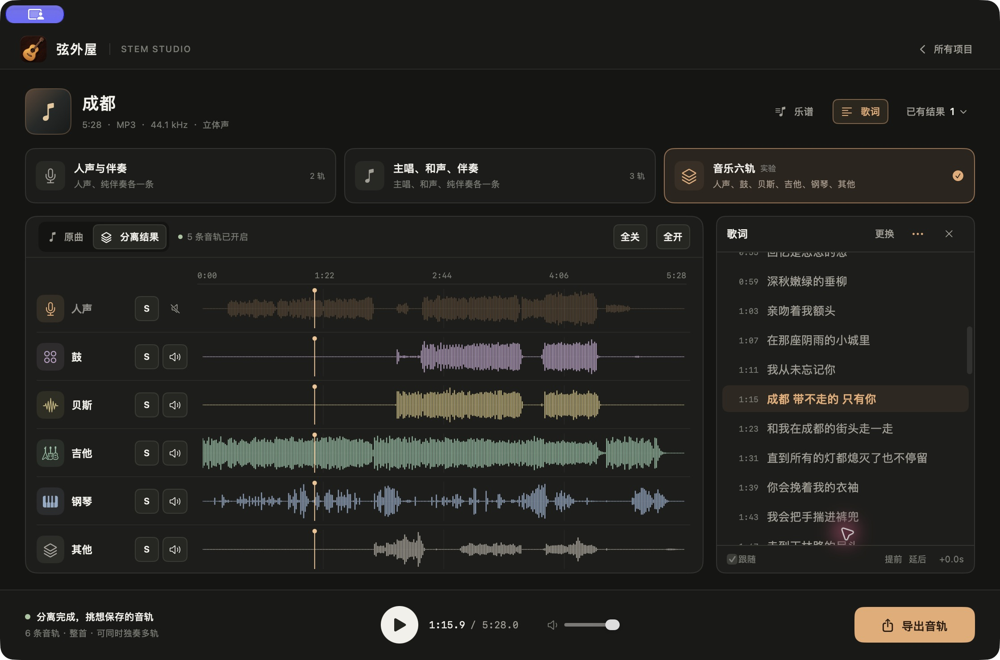
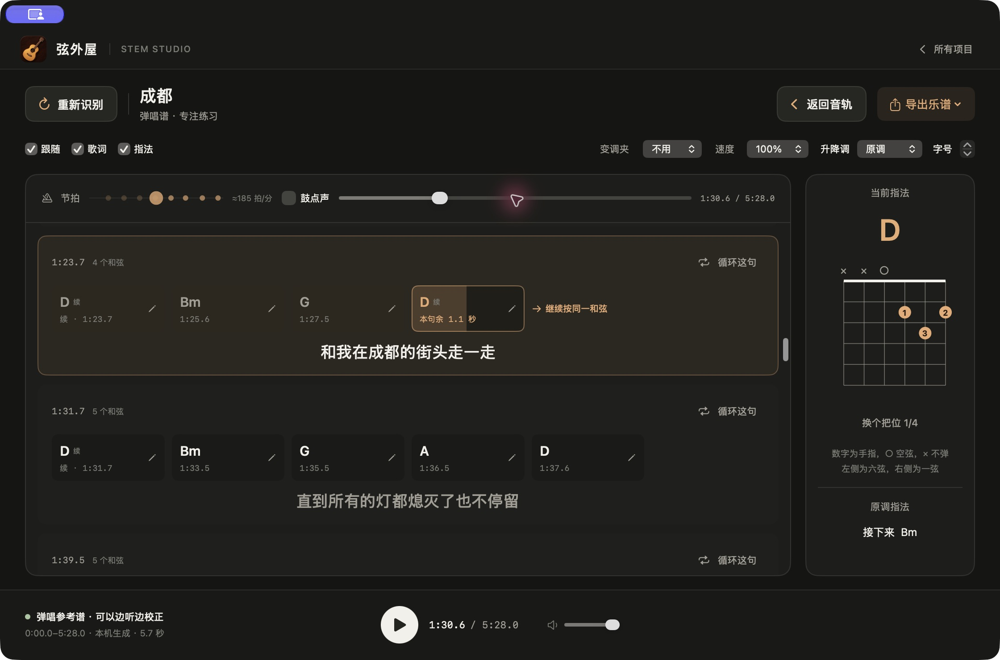

  
  <h1>弦外屋</h1>
  
<strong>拆开一首歌，练好每一段。</strong>

  
在 Mac 本地分离音轨，跟着歌词练唱，生成可以边听边校正的吉他和弦弹唱谱。

  
<a href="docs/INSTALL.md">准备与安装</a> · <a href="docs/USAGE.md">使用说明</a> · <a href="https://github.com/AidenXu-1/Xianwaiwu/issues">反馈问题</a>

**Apple 芯片 Mac · macOS 26.2+ · 1.3.8 · MIT**

[下载最新版](https://github.com/AidenXu-1/Xianwaiwu/releases/latest) · [查看源码](https://github.com/AidenXu-1/Xianwaiwu)

弦外屋把听歌、拆轨和跟弹放在同一个工作区。想听清一段吉他，可以先独奏吉他；想练和声，可以对照主唱、和声和伴奏；想跟着弹唱，可以切进乐谱页，慢下来，循环这一句。

提供 MIT 源码与商店外 Mac 安装包。App 自带运行工具，拖入“应用程序”后即可打开，无需另装 Python、Homebrew 或填写 API。首次使用分离或乐谱时自动下载所需模型，之后可离线处理。未作 Apple 公证，首次打开可能需要在系统设置中允许。请先阅读[安装说明](docs/INSTALL.md)。

## 听清每一条音轨

| 分离方式 | 得到什么 | 适合做什么 |
| --- | --- | --- |
| 人声与伴奏 | 人声、纯伴奏 | 练唱、做伴奏、听清演唱细节 |
| 主唱、和声、伴奏 | 主唱、和声、纯伴奏 | 对照和声与主旋律，练习合唱声部 |
| 音乐六轨（实验） | 人声、鼓、贝斯、吉他、钢琴、其他 | 拆开听编曲，独奏或组合试听 |

六轨分离和复杂和声可能有串音或声音损失，可以先选一小段试听，再处理整首。

## 跟着一句一句练

- **看着进度换指法**：每句的和弦格各自走满，上一句末尾提前提示是否继续按同一和弦。
- **稳稳地看谱**：同一句内保持画面静止，换句时平滑切换；歌词居中，当前指法在右侧。
- **反复练一段**：按句循环、慢速试听、升降调、变调夹和多种把位。
- **随音乐找节拍**：视觉节拍提示，可开关的轻鼓点声，暂停、跳转和循环同步。
- **听见不对就修改**：校正和弦和切换时间，保存后继续练习，导出 PDF 或 ChordPro。

自动生成的是和弦弹唱参考谱，需要按听感校正。当前指法图针对吉他，不提供原曲逐音六线谱、扫弦编配或其他乐器的专用谱。

## 已有歌词，直接跟唱

支持导入 LRC、TXT、Markdown、Word，或粘贴带时间的文字。**按内容里有没有有效时间判断能否同步，不靠文件扩展名判断。**

歌词支持逐句跟随、编辑、整体提前或延后，以及导出 LRC。没有时间或时间不完整时会提示检查，保留已有内容。当前不提供自动生成歌词或无时间歌词自动对齐，也不为歌词安装本地识别模型。

## 开始使用

1. 下载版本页的 DMG，按[安装说明](docs/INSTALL.md)将弦外屋拖入“应用程序”。
2. 导入一首歌，在「原曲」页选择整首或处理片段。
3. 选择分离方式，在「分离结果」里试听、独奏和组合音轨。
4. 需要练唱时打开「歌词」；需要跟弹时打开「乐谱」。

音轨可导出 WAV 24/16 位、FLAC 24 位、MP3 320 kbps。处理范围与已有结果独立保存，改选段不会覆盖原有结果。

## 文件与模型

项目、歌词、乐谱和试听状态保存在本机。分离、生成和弦与导出不需要云端 API，也不按歌曲收取接口费用。源码仓库不附带歌曲、分轨、模型权重或运行环境；Mac 安装包内置运行工具，模型按功能下载，常用功能全部准备后约 355 MB。下载量与存储位置见[安装说明](docs/INSTALL.md)。

模型来源、固定校验值及各组件许可分别记录，项目本身的授权不替代第三方模型的授权。详见[第三方声明](THIRD_PARTY_NOTICES.md)。

截图来自 App 实际运行，示例音频、歌词文件与分离结果不随仓库提供。

## 继续了解

- [安装与源码构建](docs/INSTALL.md)
- [操作说明](docs/USAGE.md)
- [本机检查](app/macos/测试/README.md) · [验证边界](docs/VERIFICATION.md)
- [版本记录](CHANGELOG.md)
- [第三方组件与模型](THIRD_PARTY_NOTICES.md)
- [问题反馈](https://github.com/AidenXu-1/Xianwaiwu/issues)

提出问题时，请附上 macOS 版本、芯片型号、操作步骤和错误提示。通常无需上传完整歌曲或个人项目资料。

## 代码授权

弦外屋自己的代码采用 [MIT](LICENSE)，允许使用、修改和商用并保留署名。第三方组件、指法数据及模型各自的许可见[第三方声明](THIRD_PARTY_NOTICES.md)。
